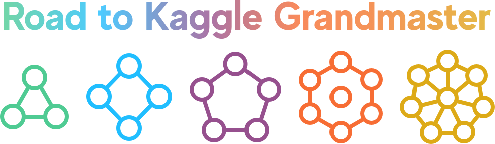

<p align="center">
  
  <h3 align="center">Kaggle Badge</h3>
  <p align="center">Add dynamically generated Kaggle Tier & Medals on your GitHub profile</p>
</p>

<p align="center">
  
  
  
</p>

<p align="center">
  
</p>

---

## Quick Start

Replace `{username}` with your Kaggle username.

### Simple Badge

```md

```

### Detailed Badge

```md


```

---

## Examples

### Simple Badge

| User | Badge |
|------|-------|
| subinium |  |
| ttagu99 |  |

### Detailed Badge (Dark)

<p>
  
  
  
</p>

### Detailed Badge (Light)

Add `/light` at the end for light theme:

```md

```

<p>
  
  
  
</p>

---

## API Reference

### Simple Badge
```
https://road-to-kaggle-grandmaster.vercel.app/api/simple/{username}
```

### Detailed Badge
```
https://road-to-kaggle-grandmaster.vercel.app/api/badges/{username}/{category}
https://road-to-kaggle-grandmaster.vercel.app/api/badges/{username}/{category}/light
```

**Categories:** `competition`, `dataset`, `notebook`

---

## Deploy Your Own

[](https://vercel.com/new/clone?repository-url=https://github.com/subinium/kaggle-badge)

---

## License

Original design licenses for tiers, medals and colors are owned by Kaggle.

MIT License - feel free to use and modify.
